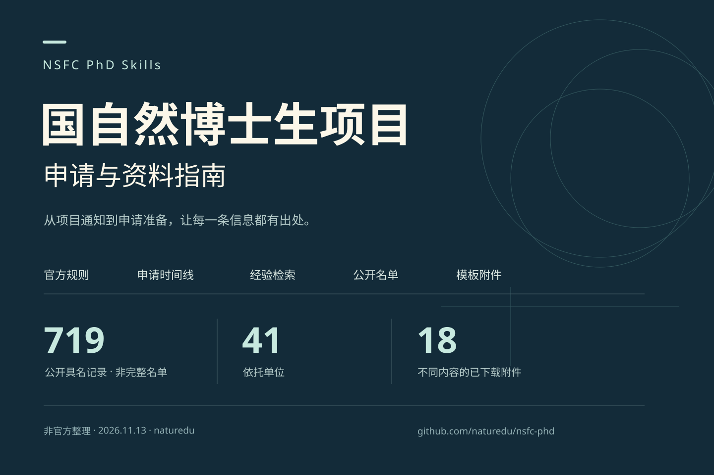

# NSFC PhD Skills｜国自然博士生项目

面向国家自然科学基金 **青年学生基础研究项目（博士研究生）** 的非官方技能包：查通知、看时间线、整理经验、查公开获批记录、找模板附件。

[完整版本下载](https://github.com/naturedu/nsfc-phd/releases) · [G0401/G0405五部分分析](references/management-2026.md) · [HTML资料册](index.html) · [129个已取得的相关链接](references/all-links.md) · [链接CSV](data/all-source-links.csv) · [封面](assets/cover.svg) · [简介](INTRO.md)

## 包含什么

| 模块 | 内容 |
|---|---|
| 项目与资格 | 官方通知及学校规则核对，区分年份、试点、预遴选和正式申报 |
| 管理口五部分分析 | G0401/G0405；2026时间线、代表作、PPT、函评与会评，标明官方规则与准备建议 |
| 申请时间线 | 历史节点、有来源的学校通知、可按个人截止日倒排的准备表 |
| 四平台经验检索 | 小红书、微信公众号、抖音、微博检索与去重方法，记录真实阅读范围 |
| 申请准备 | 科学问题、研究独立性、前期基础、材料审校及答辩练习 |
| 公开名单 | **719条、41所单位**：2023年247条、2024年176条、2025年296条 |
| 附件导航 | **35个附件/原图链接**及下载状态，申请模板、导师函等按来源和年份归档 |
| 采集工具 | Python标准库脚本：生成检索计划，清洗授权导出的帖子元数据，去重并输出覆盖报告 |

## 当前覆盖（2026-11-13）

这不是全国完整获批名单，也不是已经抓全的社交平台数据库。

- 名单：27条本轮官方页面复核、60条历史官方来源、632条二次汇总待逐项核验。每条保留来源及字段级核验说明，2026年度人员尚未纳入。
- 小红书：公开索引尚未找到可确认相关原帖，站内搜索遇登录阻碍，**未完成站内经验帖采集**。
- 微信公众号：恢复7条历史原链，本轮均未读到微信正文；另有外站转载线索。不能称为7篇已读经验帖。
- 抖音：3个候选均因主题不符排除；没有将评论命中的就业视频当成经验。
- 微博：读到3条新浪镜像单页，仅1条明确相关，且无足够可操作申请经验；未核验微博原站。
- 高校经验资料：5条来源记录对应4个活动，其中包含讲座预告和搜索摘要，已分别标注。
- 附件：35个链接中26个下载成功（25份不同内容），4个404、2个需验证码、3个连接超时。[来源与下载索引](references/attachments.md)保留全部状态；完整版本压缩包包含已下载的公开通知、空白模板与指南原图。

详见[覆盖与下一步](references/coverage.md)、[实际检索记录](references/search-log.md)、[微信公众号原链](references/wechat-sources.md)和[名单来源说明](references/roster.md)。

## 使用

将整个仓库目录命名为 `nsfc-phd`，放入支持 Agent Skills 的工具所使用的技能目录；Codex 的常见目录是 `~/.codex/skills/`。入口是根目录 `SKILL.md`，不需要把每个参考文件单独安装。

示例：

> 用 $nsfc-phd 核对我校当年博士生项目通知，做申请时间线和材料核对表。

> 用 $nsfc-phd 检索小红书和公众号的博士生国自然答辩经验，逐条保留链接和阅读深度。

> 用 $nsfc-phd 查2025年复旦公开获批记录，分清正式题名与公开研究方向。

> 用 $nsfc-phd 下载可访问的官方附件，列出无法访问的链接与原因。

[采集脚本说明](references/collector.md)包含运行方式和测试命令。脚本用于计划与整理，不提供绕过登录的爬虫，也不会把生成的检索计划算作已完成检索。

## 来源与维护

适用年度、学校、阅读层级和更新时间伴随资料保存。政策以当年基金委和依托单位正式通知为准，经验帖不构成资格、论文数量或成功率门槛。2026年基金委[通告](https://www.nsfc.gov.cn/p1/3381/2824/99667.html)对AI辅助有人工核验和声明要求，不得直接使用AI生成的申请书；本技能侧重资料整理、准备与审校。

资料采用链接、事实性结构化记录及简短转述。原文章、视频、图片、模板及附件的权利仍属各自权利人；本仓库不授予第三方内容再分发许可。纠错时请提供公开原始来源、年度和具体字段，不提交私人申请书、联系方式或登录信息。
